<div align="center">

# Scamp

### A teaching example of sockets and input monitoring, for closed lab use only.

A small terminal program that listens on a TCP port and, once a client connects, streams locally captured keyboard events over that socket. It exists to demonstrate how socket servers and input listeners work — not to be deployed against anyone.


</div>

<div align="center">

</div>

---

<div align="center">

</div>

> ### Read this first
> Scamp captures keystrokes. Running software that records another person's keyboard without their informed consent is illegal in most countries and is a serious offence. This project is published **purely as a learning artifact** for socket programming and input-event handling, to be run only on machines you own, in an isolated lab, or in a CTF you are authorized to play. Do not deploy it against anyone else. The author accepts no liability for misuse.

---

## What it demonstrates

Scamp is a single-file example that ties together three beginner-to-intermediate concepts:

- A TCP socket **server** that binds a port and accepts a connection
- A keyboard **listener** (via `pynput`) that turns key events into text
- **Threading**, so a live status animation runs while the socket work happens

When started, it clears the screen, prints an ASCII banner, binds the port, and shows a listening animation. When a client connects, it stops the animation and begins forwarding captured key events over the socket in real time. Everything is terminal-based.

---

## Features

| Feature | Detail |
|---|---|
| TCP socket server | `AF_INET` / `SOCK_STREAM`, accepts a single connection |
| Live listening animation | Runs on its own thread while waiting |
| ASCII banner | Shown on startup |
| Key-event capture | `pynput.keyboard.Listener`; special keys (ENTER, BACKSPACE, …) are labelled |
| Clean shutdown | Exits safely on Ctrl+C and on socket/thread errors |

---

## Requirements

- Python 3.x
- `pynput`

```bash
pip install pynput
```

## Running it (in your own lab)

```bash
python3 Scamp.py
```

| Setting | Default |
|---|---|
| HOST | `0.0.0.0` |
| PORT | `8080` |

---

## Security notes

- Traffic over the socket is **not encrypted** — this is a teaching example, not a secure channel.
- Intended strictly for **educational, lab, and CTF** environments.
- Use on systems or people without explicit authorization is unethical and illegal.
